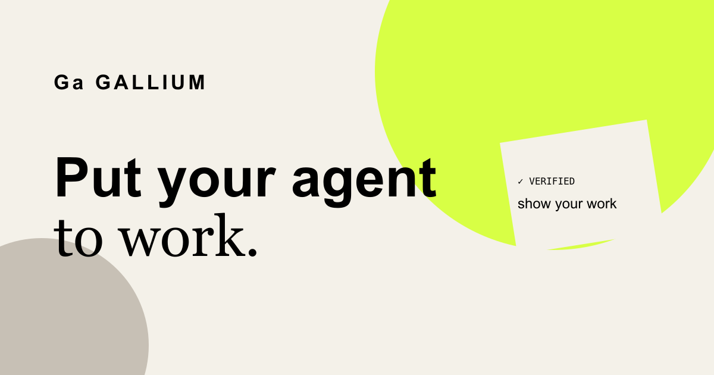

# Gallium



Use Gallium in place of your agent's default browser skill. The skill hands the whole job to a local engine through MCP or the CLI. Gallium can fetch a public document directly or switch to Chrome if the answer takes a search or a click. For a change you've configured, it reads back the result.

[Visit the website](https://davidjbeveridge.github.io/gallium/) · [Setup and configuration](docs/guide.md) · [Validation](VALIDATION.md)

## Run the demo

With **Node 24 or later**, run this from a terminal:

```sh
git clone https://github.com/davidjbeveridge/gallium.git
cd gallium
npm run demo
```

The demo uses a temporary local fixture. It needs no browser, account, API key, or dependency install. It saves a profile name, checks that a repeat request skips the save, then shows that a pause survives a restart and a human can finish the task.

```text
firstOperation                       verified
repeatResult                         ALREADY_VERIFIED
pauseSurvivedRestart                  true
actionsAfterHumanCompletedGoal        0
```

## What can you hand off?

| Task | What Gallium does |
| --- | --- |
| **Quote a line from a public guide** | Fetches the text directly when it can and returns the passage with its URL. |
| **Find an answer on a live page** | Uses Chrome to follow links, search, or wait for content. One request covered three Next clicks in the quote demo. |
| **Change a setting on a configured account** | Checks the account, uses an allowed route, and independently reads back the result. |
| **Take over partway through** | Pauses the scope, releases the browser debugger when handoff is confirmed, and waits for an explicit handback. |

Public exploration needs a configured model router. Signed-in tasks and changes need a procedure that defines the account, actions, and verification. The current browser integration uses desktop Chrome and requires explicit extension setup.

[See the five task demos](https://davidjbeveridge.github.io/gallium/#workflow)

## Install the engine

```sh
npm ci
npm run install:local
~/.local/bin/gallium --help
```

`install:local` installs the CLI and routing skill from this checkout. If Codex is
installed, it also registers Gallium's MCP server; otherwise it skips that one
step and tells you how to finish later. Open a new Codex chat after MCP
registration. Follow the [Chrome setup and fixture walkthrough](docs/guide.md#connect-chrome)
to try the browser route on a local test page. For public website tasks, see the
[model configuration](docs/guide.md#shared-service-and-internal-routing).

For an MCP client, submit a goal with `web_task`:

```json
{
  "operationId": "rfc2324-status",
  "goal": "What does HTTP status 418 mean in this document?",
  "target": "https://www.rfc-editor.org/rfc/rfc2324.txt"
}
```

The equivalent CLI call is:

```sh
gallium task --operation rfc2324-status \
  --goal 'What does HTTP status 418 mean in this document?' \
  --target https://www.rfc-editor.org/rfc/rfc2324.txt
```

## Add the skill to a project

Run this from the project where you use your agent:

```sh
npx skills add davidjbeveridge/gallium
```

The skill uses the CLI or MCP server from the engine installer. Open a new agent session to load it. Add “Use the Gallium skill for web tasks.” to your project's agent instructions to make it your default. [Engine setup](#install-the-engine)

## How control and verification work

For public goals, Gallium can move from a direct HTTPS read to live exploration when the document does not supply the answer. For configured goals, the model judges which procedures fit and code selects one in a fixed order: direct HTTP, a request inside the signed-in browser session, then browser interaction. The selection persists for the operation. If a write might have succeeded, Gallium checks the result before retrying. Reuse the same operation ID and inputs after an interruption.

Use `web_control` or the CLI to pause a scope. Gallium keeps that pause across restarts. After an explicit resume, reissue the operation to check whether you already completed it during handoff.

The [validation report](VALIDATION.md) describes the real Chrome fixture tests, including independent save verification, handoff, restart, and handback with zero extra actions. The [current state](docs/STATE.md) records the tested boundaries for public exploration and signed-in workflows.

## Develop

```sh
npm ci
npm run check
npm run build:extension
npm run test:browser
```

The browser gate uses installed Chrome and a disposable profile. See the [configuration guide](docs/guide.md), [architecture plan](docs/build-plan.md), and [third-party notices](THIRD_PARTY_NOTICES.md).
